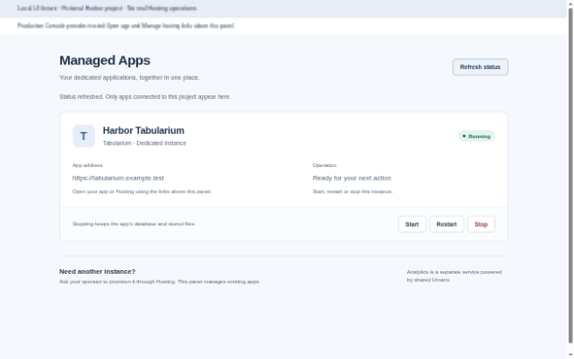

# Managed Apps

Operate dedicated applications connected to a Webdock project. The initial app is **Tabularium**: view its status and address, then start, stop or restart the instance. Webdock Console provides trusted **Open app** and **Manage hosting** links above the plugin panel.

Provisioning stays in the existing operator Hosting workflow. This extension manages existing instances; it does not provision apps, configure their internal business settings, or manage subscriptions. Shared Umami analytics remains a separate service.

## Release status

Developer alpha `0.1.0-alpha.1`. The manifest pins the reviewed OCI image by digest. This release is not installed in the production Console. The host must include the `apps` service, capabilities and Console launch links added for this extension. A stock host without that service cannot run it.

## Surfaces

| Action         | Input                                         | Capability           |
| -------------- | --------------------------------------------- | -------------------- |
| `apps.list`    | `{}`                                          | `plugin.apps.read`   |
| `apps.get`     | `app_id`                                      | `plugin.apps.read`   |
| `apps.start`   | `app_id`, `revision`, `subscription_revision` | `plugin.apps.manage` |
| `apps.stop`    | Same                                          | `plugin.apps.manage` |
| `apps.restart` | Same                                          | `plugin.apps.manage` |

All actions are exposed through the manifest's API and MCP routes. Reads return the narrow managed app contract. Commands return `{operation_id, app_id, status}`; refresh status to observe completion. The host derives project authority from a verified invocation, checks its operator binding and current revisions, and executes the existing Hosting operation. Stopping preserves database and persistent storage according to Hosting semantics.

No tenant selector, HTTP binding, provider URL, cluster credential, database credential or application admin token is accepted by the extension. Internal branding, kinds, manifests and sign-in settings remain inside the dedicated application.

## Run and verify

```sh
bun install --frozen-lockfile --ignore-scripts
bun test
bun run build
docker build -t webdock-managed-apps:0.1.0-alpha.1 .
bun run test:image
bun run preview
```

The preview at `http://127.0.0.1:3490` uses a clearly labeled in-memory UI fixture. It exercises signed runtime invocations and the scripts-only MessagePort UI with simulated app operations. It does **not** contact Hosting, Kubernetes, a database or a deployed Tabularium. `/proof` records fixture actions for browser acceptance. No production or real deployment evidence is implied by this preview.

The SDK tarball in `vendor/` includes the host's new `apps` contract. No new runtime framework is introduced.

## Screenshots

Local UI fixture with a fictional Harbor project and simulated Hosting operations. Production Console supplies trusted app and Hosting links above the panel.




## Deployment boundary

Private runtime on port **3443**, TLS required. Public UI upstream on port **3444**, exposed only through an HTTPS proxy. Never route the action listener publicly. Container runs as `bun` and supports a read-only filesystem.

Required environment:

- `WEBDOCK_PLUGIN_RUNTIME_TOKEN`: host-provisioned random bearer credential, at least 32 characters.
- `WEBDOCK_PLUGIN_HOST_URL`: canonical HTTPS host callback origin.
- `WEBDOCK_PLUGIN_CONSOLE_ORIGIN`: canonical HTTPS Console origin for iframe ancestry.
- `WEBDOCK_PLUGIN_HOST_PUBLIC_KEY`: Ed25519 public key PEM for invocation verification.
- `WEBDOCK_PLUGIN_GENERATION`: active positive installation generation.
- `WEBDOCK_PLUGIN_TLS_CERT`, `WEBDOCK_PLUGIN_TLS_KEY`: mounted private runtime TLS files.

Runtime requests require the bearer credential plus a current signed `X-Plugin-Invocation`. The plugin verifies plugin ID, generation, action, project claim format, lifetime and callback origin. The host rechecks live project authority and binding on every `apps` service call. Errors exposed to the UI are generic and contain no provider details.

The iframe uses `sandbox="allow-scripts"`, a one-time nonce handshake and a private MessagePort. It cannot fetch providers, submit forms or open popups. App addresses are plain text; navigation is owned by authenticated Console chrome outside the iframe.

## EU CI

Source pushes and trusted same-repository pull requests run the frozen dependency install, build and unit tests through the dedicated rootless EU builder. External fork PRs cannot run on this persistent trusted runner. No hosted fallback, Docker daemon or provider/customer credentials are used.

The manual `Plugin EU build` workflow can push a checked image candidate by enabling `publish_image`. It records the immutable image/source identity; existing versioned registry manifests and releases are unchanged. A new registry version still requires its proper manifest and signed integrity verification.
